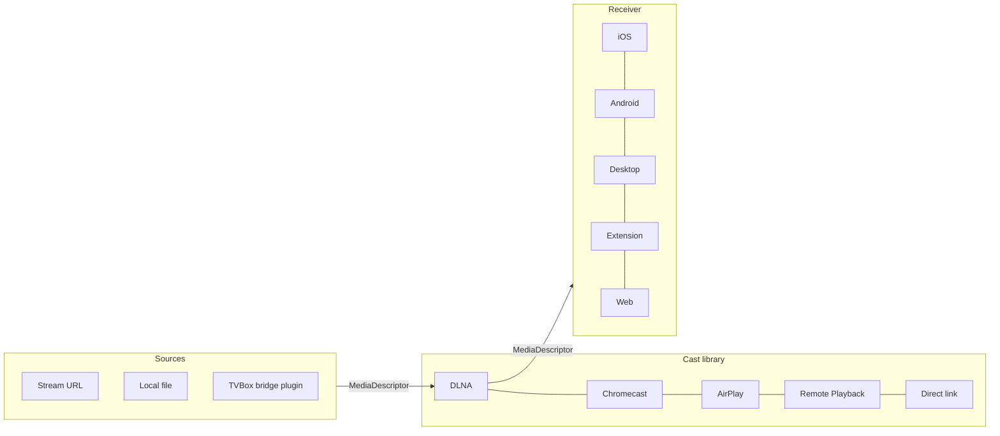
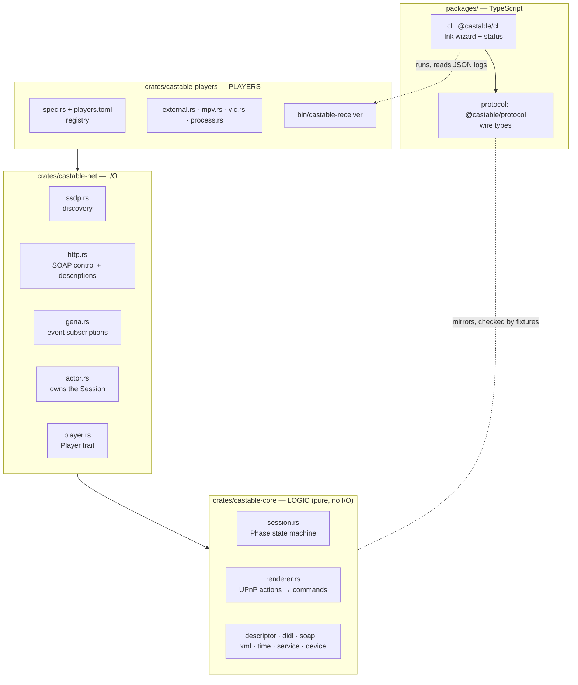
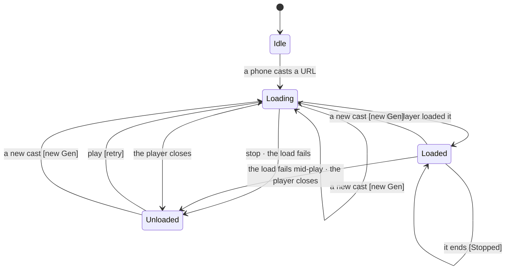

# Castable architecture

How the Castable core is put together and why. **This is a living document.** Any change to a
layer, a shared type, a state or a rule below updates this file in the same PR (see
[Keeping this current](#keeping-this-current)).

Related: [`castable-universal/docs/ARCHITECTURE.md`](https://github.com/vincecao/castable-universal/blob/main/docs/ARCHITECTURE.md)
covers the apps that sit on top of this core.

## 1. The bigger picture

Castable is three products that share one data type, the **`MediaDescriptor`** (a URL plus how to
fetch it: headers, referer, kind, title).



| Repo | Holds |
| --- | --- |
| **castable-core** (this repo) | Everything a receiver *decides*: the session, the DLNA/UPnP protocol, discovery and control over the network, desktop players, the setup CLI, and the wire types for TypeScript. No UI. |
| **castable-universal** | Everything a receiver *shows*: shared React screens, the web video player, and one folder per platform. It includes this repo as the `core/` submodule. |

Today the core implements the **DLNA receiver**. The other cast protocols and the sources are
roadmap; they plug in at the same seams (§4).

## 2. Layers



Dependencies only point down. `castable-core` depends on serde, quick-xml and thiserror; it never
touches a socket, a clock or a process, so all of its behaviour is unit-testable.

| Layer | Path | May do | Must not do |
| --- | --- | --- | --- |
| Logic | `crates/castable-core` | Parse and build UPnP XML, decide state transitions | I/O of any kind, logging setup, async runtime |
| I/O | `crates/castable-net` | Sockets, HTTP, multicast, timers, tracing | Decide session behaviour (it asks the core) |
| Players | `crates/castable-players` | Spawn programs, speak mpv IPC / VLC HTTP, read config | Know about UPnP |
| Wire | `packages/protocol` | Types only | Depend on anything |
| CLI | `packages/cli` | Terminal UI, run the receiver binary | Duplicate OS logic the binary already has |

## 3. The session (the heart)

`session.rs` holds the whole receiver state as **one enum**. Each variant carries only the data
that is valid in it:

```rust
enum Phase {
    Idle,
    Loading  { cast: Cast, then: AfterLoad },      // AfterLoad = Hold | Play
    Loaded   { cast: Cast, playback: Playback },   // Stopped | Playing | Paused
    Unloaded { cast: Cast, why: Unloaded },        // StoppedWhileLoading | LoadFailed(reason) | PlayerClosed
}
```



Inputs come from two sides and produce **`PlayerCommand`s** for whoever plays the video:

| Input | Type | Comes from |
| --- | --- | --- |
| Sender commands | `SenderCommand` (`SetUri`, `Play`, `Pause`, `Stop`, `Seek`) | A phone, via SOAP. Volume and mute skip the session: the renderer turns them straight into `SetVolume` / `SetMuted` |
| Screen presses | `ScreenCommand { gen, command }` | The receiver's own screen, remote or keyboard. `gen` is the cast the screen showed; a press on a replaced cast is dropped |
| Player events | `PlayerEvent` (`Loaded`, `LoadFailed`, `Progress`, `Ended`, `Closed`) — each tagged with a `Gen` | The player. `Closed`: it went away (process exited, window closed), so nothing is loaded |
| Output | `PlayerCommand` (`Load{gen,media}`, `Play`, `Pause`, `Stop`, `Seek`, `SetVolume`, `SetMuted`) | → the player |

The transitions are pure functions, `Phase::on_sender(self, cmd) -> (Phase, Result<Vec<PlayerCommand>, UpnpError>)`
and `Phase::on_player(self, ev) -> (Phase, Vec<PlayerCommand>)`. A refusal returns the phase
unchanged, so there is no hand-written rollback.

### The four rules

Checked first in TLA+ (`models/cast-session/`), then against the Rust code by an exhaustive test
(`tests/session_model.rs`, every input sequence to depth 14). Each holds by construction:

| Rule | How the design guarantees it |
| --- | --- |
| What senders see matches the screen | The UPnP `TransportState` is *computed* from `Phase`, never stored |
| A replaced cast never stays on screen | One `Cast` at a time; a new cast bumps the `Gen`; events from an old `Gen` are dropped |
| Pressing Play is never lost | Play while loading becomes `AfterLoad::Play` instead of UPnP error 701 |
| "Loading" only while something loads | A stopped or failed load goes to `Unloaded`, which reports Stopped |

Also by design: a **seek while loading** is stored in `cast.position` and applied as `[Seek, Play]`
once loaded; a **live stream** refuses Seek with `SeekModeNotSupported`; a **mid-play load failure**
and the **end of a video** both send `Stop`, so whatever was in flight the player ends up still; a
**closed player** moves to `Unloaded`, where Play loads the video again; a **screen press** carries
the `gen` of the view it was made on (views carry `gen`), and a stale one is dropped.

These last three were found by the end-to-end model (§11).

## 4. One cast, end to end

```mermaid
sequenceDiagram
  participant Phone
  participant SSDP as ssdp.rs
  participant HTTP as http.rs
  participant Actor as actor.rs
  participant Core as Session (core)
  participant Player as Player (mpv/VLC/web)
  Phone->>SSDP: M-SEARCH (239.255.255.250:1900)
  SSDP-->>Phone: LOCATION http://ip:port/device.xml
  Phone->>HTTP: GET device.xml, service XML
  Phone->>HTTP: SUBSCRIBE AVTransport (GENA)
  Phone->>HTTP: SOAP SetAVTransportURI(url, DIDL-Lite)
  HTTP->>Actor: Action::parse → SenderCommand::SetUri
  Actor->>Core: handle(input)
  Core-->>Actor: Loading + [Load{gen, media}]
  Actor->>Player: PlayerCommand::Load
  Phone->>HTTP: SOAP Play
  Actor->>Core: Play → stored as AfterLoad::Play
  Player-->>Actor: PlayerEvent::Loaded{gen}
  Actor->>Core: Loaded → [Play]
  Actor->>Player: PlayerCommand::Play
  Actor-->>Phone: NOTIFY LastChange (TransportState=PLAYING)
```

**The actor** (`actor.rs`) is the only owner of the `Session`. HTTP handlers and the player send it
messages over channels; it applies them in order, so there are no locks and no races on state.

**The `Player` seam** (`player.rs`) is how anything plays video:

```rust
trait Player: Send {
    fn apply(&mut self, cmd: PlayerCommand) -> impl Future<Output = ()>;
}
```

`castable_net::start(config)` returns a `Receiver` with a command stream and a `Handle` for
reporting `PlayerEvent`s back (`player_event`) and for presses on the receiver's own screen
(`screen_command`). A desktop app, a phone app or a test fake all implement the same
seam. The dispatch is generic (`run<P: Player>`), not `dyn`.

## 5. Players

Desktop players are **data, not code**. `crates/castable-players/players.toml` lists each one:

```toml
[players.mpv]
description = "mpv: plays almost anything, full control"
program = ["mpv", "C:\\Program Files\\mpv\\mpv.exe"]   # first one found is used
args = ["--pause", "--force-window=immediate", "--keep-open=no", "--input-ipc-server={ipc}",
        "--force-media-title={title}", "--http-header-fields={headers}", "{url}"]
control = "mpv-ipc"   # mpv-ipc | vlc-http | launch
```

| `control` | What works | How |
| --- | --- | --- |
| `mpv-ipc` | Full control and real events | JSON IPC over a Unix socket, or a named pipe on Windows |
| `vlc-http` | Full control and real events | VLC's web interface, polled every 500 ms |
| `launch` | Start and stop | Spawn the program; `Loaded` is assumed; Stop closes it and reports `Closed` |

Placeholders: `{url} {title} {referer} {user_agent} {headers} {ipc} {port} {password}`. An argument
whose placeholder has no value is left out; a group such as `["-window_title", "{title}"]` is dropped whole. Specs are validated on load
(unknown placeholder, missing `{url}`, a control that needs `{ipc}` or `{port}`), and errors name
the player. Users extend or override the list in their own `players.toml` in the config folder.

To add a player: add an entry, run `castable-receiver --players` to check it, open a PR. A player
with a new control protocol is the only case that needs Rust: a new `Control` variant and a module
like `mpv.rs`.

## 6. Configuration and the CLI

| What | Where |
| --- | --- |
| Settings (`name`, `player`, `port`, `log`) | `config.toml` in the config folder; flags override |
| User players | `players.toml` in the config folder |
| Config folder | `%APPDATA%\castable` on Windows, else `$XDG_CONFIG_HOME/castable` or `~/.config/castable` |
| Overrides | `$CASTABLE_CONFIG`, `$CASTABLE_PLAYERS` |

The receiver binary is the **single source of OS facts**: the CLI asks it for the player list
(`--players --json`) and the settings path (`--print-config-path`) instead of re-implementing them
in TypeScript.

`packages/cli` (`pnpm castable`) has two screens, each a pure reducer with an Ink view:

- **Setup wizard** (`wizard.ts`): `Step = name | player | port | review | done`. Arrow keys, Enter
  and Esc. Writes `config.toml`.
- **Live status** (`status.ts`): runs the receiver with `--log json` and folds each log line
  (`ready`, `transport`, `player command`, `player event`, `control refused`) into a status view.
  Keys: `q` stop, `l` open the log file (its path comes in the `ready` line), `r` write a report
  next to it and open it.

## 7. Logging

Logs go through `tracing` with structured fields, never formatted strings, so the same events are
readable (`--log pretty`) and machine-readable (`--log json`, which the CLI consumes). Fields are
recorded only when the level is enabled, so logging costs nothing when off. Filter with `RUST_LOG`,
for example `RUST_LOG=castable_net=debug`.

| Message | Fields |
| --- | --- |
| `ready` | `name`, `player`, `control`, `url` |
| `control` / `control refused` | `action` (+ `code`, `error`, `category`, `upnp` when refused) |
| `player command` | `command`, plus `gen`, `url`, `title`, `live` on load, `to_s` on seek, `volume` |
| `player event` | `event` (`loaded`, `load_failed`, `ended`, `closed`), `gen` (+ `code`, `error`, `category`, `detail`, `summary` on a failed load) |
| `player says` (debug) | `output`: a line the player printed (+ `code`, `error` if it names a known error) |
| `screen press` / `screen press refused` | `command`, `gen` (+ `code`, `error` when refused) |
| `transport` | `from`, `to`, `gen` |
| `subscribed` / `unsubscribed` | `service`, `sid`, `renew`, `timeout_s` |
| HTTP request (debug) | `peer`, `method`, `path`, `status`, `elapsed_us` |

**Log file and reports.** Besides the terminal (info), every run writes JSON at debug, including
player output, to `logs/receiver.log` in the config folder, keeping the previous run as
`receiver.1.log`. `castable-receiver --report` (`castable report`) builds a Markdown report from
them: version, OS, settings, players, a count of error codes, and the last 300 lines, with URL
queries, passwords, tokens and cookies redacted (`report.rs`).

### 7.1 Errors

One catalog for every error: `CastError { code: ErrorCode, detail }` in `castable-core`
(`errors.rs`). Codes sit in buckets (`ErrorCategory`) whose digit starts the number: 1xx player,
2xx network, 4xx media, 6xx control (UPnP faults map one to one), 7xx config, 8xx system, 9xx
unknown. JSON carries `code`, `id` (`E403`), `category` and `detail`; logs carry the same fields.

- **Players map, the core names.** Each source turns its own signals into a code: Rust players
  through one table of phrases in `castable-players/src/diagnose.rs` (`HTTP error 403` →
  `forbidden`), the web player from `MediaError` codes, the receiver from I/O errors. The player's
  own words become `detail`.
- **Screens translate codes.** A message per category, plus specific ones per code where useful.
  A new code shows its category's message until it gets its own.
- **Adding a code** is one line in the `codes!` table. A test keeps numbers unique and in their
  bucket; `fixtures/errors.ts` fails `pnpm typecheck` if TypeScript's `ErrorCode` falls behind;
  `docs/ERRORS.md` is generated from the table.

## 8. Cross-language types

Rust is the source of truth. TypeScript mirrors live in `packages/protocol/src/index.ts`.
`tests/fixtures.rs` serialises real values (views, commands, events) into `fixtures/*.json` and
`fixtures/*.ts`; `pnpm typecheck` then fails if a mirror has drifted. After changing a shared type:

```sh
UPDATE_FIXTURES=1 cargo test --test fixtures && pnpm typecheck
```

## 9. Design rules

1. **Discriminated unions everywhere.** State is one enum whose variants carry only valid data
   (`Phase`, `Delivery`, `Action`, `PlayerCommand`, `PlayerEvent`, `Control`, the wizard's `Step`).
   TypeScript mirrors them as tagged unions and matches exhaustively (`never`).
2. **Pure transitions.** Session, wizard and status are reducers. I/O lives only at the edges.
3. **Derive, don't store.** Transport state, available actions and event payloads are computed.
4. **One source per fact.** Services and state variables in `service.rs`; players in
   `players.toml`; OS paths in the receiver binary; wire types in Rust.
5. **Model first.** Behaviour changes to the session start in `models/cast-session/`, and the
   exhaustive test is extended to match.
6. **Small public surface.** Only `device`, `service` and `soap` are public modules of the core;
   everything else is re-exported deliberately from `lib.rs`.

## 10. Testing

| Check | Covers |
| --- | --- |
| `cargo test` | Unit tests, the session model test, loopback end-to-end (`castable-net/tests/e2e.rs`), fixtures |
| TLC on `fixed.cfg` / `naive.cfg` | `fixed` must pass, `naive` must fail (proves the model can catch the bugs) |
| TLC on `models/system/*.cfg` | The whole system end to end (phone, core, screen, player, queues): `current-*` must pass, `before-fixes-*` must fail |
| `pnpm typecheck && pnpm test` | Wire types against fixtures, CLI reducers |
| `scripts/fake-sender.sh` | Acts as a phone against a running receiver |
| CI | All of the above on Linux, macOS and Windows |

## 11. The end-to-end model

[`models/system/`](../models/system/README.md) checks the whole system, not just the session: a
phone and the receiver's screen send commands, the core and the player talk over queues, and the
screen updates late, so any message can be in flight. Two rules:

| Rule | Meaning |
| --- | --- |
| `PlaysWhatCoreSays` | Once every message has arrived, the video plays exactly when the core (and so every phone and the screen) says it plays, and it is the current cast |
| `PressActsOnItsCast` | A press on the receiver's screen acts on the cast you saw when you pressed it |

It found three bugs in the first design, all fixed, each with a regression test:

| # | Bug | Fix |
| --- | --- | --- |
| 1 | A screen press could act on the next video if a phone cast in between | `ScreenCommand { gen, command }`; stale presses are dropped |
| 2 | With an external player, Play after the video ended or the window closed went nowhere | `PlayerEvent::Closed` → `Unloaded`, where Play reloads |
| 3 | With the web player, a Play crossing the end left it playing while everything said Stopped | `Ended` also sends `Stop` |

The current design holds both rules (`current-*.cfg`); the design before the fixes is kept
(`before-fixes-*.cfg`) and must still fail, so CI proves the model can catch them.

## 12. Roadmap and open decisions

- Desktop app (Tauri) wiring `castable-net` to `@castable/player-web` and `@castable/ui`.
- iOS and Android receivers using the same core (iOS needs Apple's multicast entitlement).
- Other cast protocols (Chromecast, AirPlay) and sources (TVBox bridge) at the same seams.
- Open: publish `@castable/protocol` to npm instead of the submodule; split the CLI into its own
  package release.

## Keeping this current

This file describes the code as it is, not as it was planned. When a PR changes any of these, it
updates the matching section here:

- a crate, package or layer boundary (§2)
- a variant of `Phase`, `PlayerCommand`, `PlayerEvent` or `SenderCommand`, or a session rule (§3);
  re-run `models/system` (§11)
- the `Player` seam or the cast flow (§4)
- the `players.toml` schema or a control protocol (§5)
- config locations, CLI screens, log messages or error codes (§6, §7, §7.1)

The PR template asks about it. If a section is out of date, fixing it is a welcome PR on its own.
