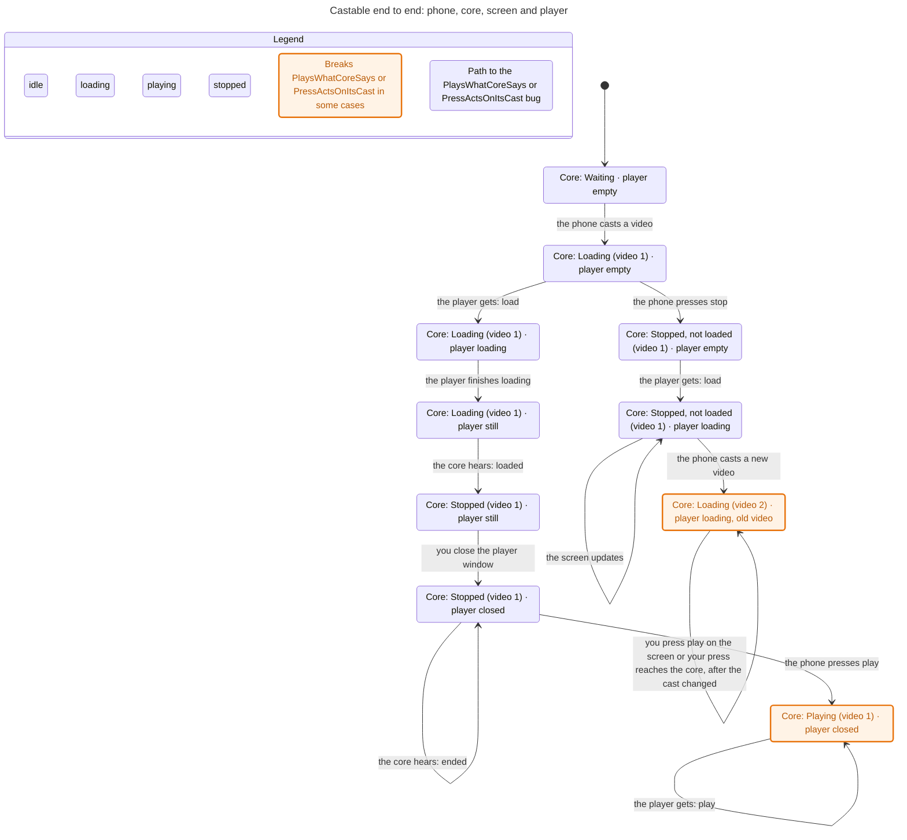
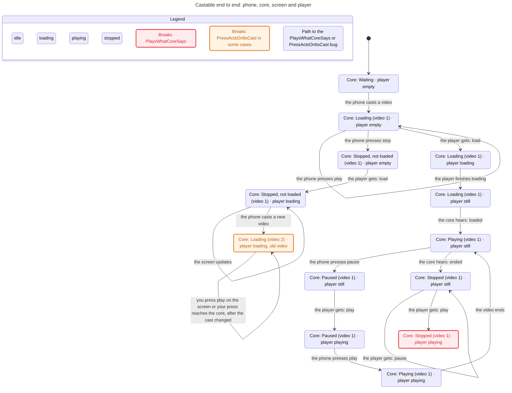

# End-to-end model: the whole plan

`models/cast-session` checks the core session on its own. This model checks the
plan in [`docs/ARCHITECTURE.md`](../../docs/ARCHITECTURE.md) as a whole: a phone
and the receiver's own screen send commands to the core, the core sends
`PlayerCommand`s to a player over a queue, the player reports `PlayerEvent`s back
over another queue, and the screen shows the core's view after a delay. Any
message can still be in flight when the next thing happens.

| Constant | Meaning |
| --- | --- |
| `Kind = "process"` | An external player (mpv, IINA, VLC): its process exits when the video ends or you close its window |
| `Kind = "web"` | `@castable/player-web`: the `<video>` stays loaded after it ends |
| `Fixed = FALSE` | The plan as the code is written today |
| `Fixed = TRUE` | With the three fixes below |
| `MaxGen = 2`, `MaxQ = 2` | Up to two casts; up to two messages queued each way |

## Rules

| Rule | Meaning |
| --- | --- |
| `PlaysWhatCoreSays` | Once every message has arrived, the video plays exactly when the core (and so every phone and the screen) says it plays, and it is the current cast |
| `PressActsOnItsCast` | A press on the receiver's screen acts on the cast you saw when you pressed it |

## Results

| Config | States | `PlaysWhatCoreSays` | `PressActsOnItsCast` |
| --- | --- | --- | --- |
| `naive-process.cfg` | 15,835 | **breaks** (bug 2) | **breaks** (bug 1) |
| `naive-web.cfg` | 27,633 | **breaks** (bug 3) | **breaks** (bug 1) |
| `fixed-process.cfg` | 8,451 | holds | holds |
| `fixed-web.cfg` | 10,587 | holds | holds |

No config deadlocks. The fixed models are past the 500-state chart budget, so
only the bug paths are drawn.

## The three bugs

Each was confirmed against the real code, not only the model.

**1. A press on the screen can act on the next video.** A screen press is a
`SenderCommand` with no cast ID (`Intent` in `@castable/ui`). If a phone casts a
new video between what you saw and your press reaching the core, the press
applies to the new video. With seek, the new video jumps to a time picked on the
old one.
*Fix:* screen presses carry the `gen` of the view they were made on; the core
drops a press whose `gen` is no longer current. Phone commands are unchanged
(UPnP has no such ID).

0. Core: Waiting · player empty
1. the phone casts a video: Core: Loading (video 1) · player empty
2. the phone presses stop: Core: Stopped, not loaded (video 1) · player empty
3. the player gets: load: Core: Stopped, not loaded (video 1) · player loading
4. the screen updates: Core: Stopped, not loaded (video 1) · player loading
5. the phone casts a new video: Core: Loading (video 2) · player loading, old video
6. you press play on the screen: Core: Loading (video 2) · player loading, old video
7. your press reaches the core, after the cast changed: Core: Loading (video 2) · player loading, old video

**2. With mpv or VLC, Play after the video ends (or after you close the player
window) does nothing, while the phone shows Playing.** mpv runs with
`--keep-open=no`, so its process exits at the end; a clean exit is reported as
`ended`; the core keeps the media as loaded (Stopped), so the next Play is sent
to a process that is gone and `External::send` drops it.
*Fix:* `ended` says whether the player is gone; when it is, the core moves to
"Stopped, not loaded", where Play loads the video again (as it already does
after a failed load).

0. Core: Waiting · player empty
1. the phone casts a video: Core: Loading (video 1) · player empty
2. the player gets: load: Core: Loading (video 1) · player loading
3. the player finishes loading: Core: Loading (video 1) · player still
4. the core hears: loaded: Core: Stopped (video 1) · player still
5. you close the player window: Core: Stopped (video 1) · player closed
6. the core hears: ended: Core: Stopped (video 1) · player closed
7. the phone presses play: Core: Playing (video 1) · player closed
8. the player gets: play: Core: Playing (video 1) · player closed

**3. With the web player, a Play that crosses the end of the video leaves it
playing while everything says Stopped.** The video ends while a play is still
queued; the browser's `play()` restarts an ended video; then the late `ended`
event moves the core to Stopped.
*Fix:* on `ended`, the core also sends `Stop` (rewind and pause), as it already
does for a failure mid-play. Whatever was in flight, the player ends up still.

0. Core: Waiting · player empty
1. the phone casts a video: Core: Loading (video 1) · player empty
2. the phone presses play: Core: Loading (video 1) · player empty
3. the player gets: load: Core: Loading (video 1) · player loading
4. the player finishes loading: Core: Loading (video 1) · player still
5. the core hears: loaded: Core: Playing (video 1) · player still
6. the phone presses pause: Core: Paused (video 1) · player still
7. the player gets: play: Core: Paused (video 1) · player playing
8. the phone presses play: Core: Playing (video 1) · player playing
9. the video ends: Core: Playing (video 1) · player still
10. the core hears: ended: Core: Stopped (video 1) · player still
11. the player gets: pause: Core: Stopped (video 1) · player still
12. the player gets: play: Core: Stopped (video 1) · player playing

## Charts

The bug paths for the plan as written, with an external player:



With the web player:



## Run

Plain TLC (as CI does):

```sh
java -XX:+UseParallelGC -cp tla2tools.jar tlc2.TLC -config fixed-process.cfg -workers 1 CastSystem.tla
```

With the statechart skill, to draw a chart and get each bug path again:

```sh
statechart CastSystem.tla --config naive-web.cfg --view view.mjs --out out-naive-web
```

The skill needs TLC 1.7.4.

## What the model leaves out

Seek positions and durations (a seek is one abstract step), volume and mute,
GENA delivery to phones (they read the same derived state as the screen), more
than two casts, a player that fails mid-play, and timing: every interleaving of
queued messages is checked, not how likely each one is.
